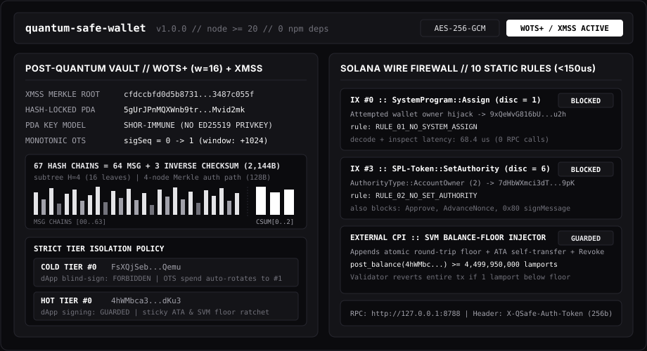

# quantum-safe-wallet




Quantum computers might still be warming up in some lab, bhai, but Solana drainers are working overtime tonight.

Runs on zero npm packages, pure Node crypto, and 3am masala chai.

## what is this

* Post-quantum key vault using WOTS+ (67 hash chains) and XMSS Merkle trees.
* Off-curve SHA-256 vault address with no Ed25519 private key to steal.
* Local AES-256-GCM encrypted key file locked behind your passphrase.
* Separate COLD and HOT keys so your savings wallet never touches sketchy dApps.
* Fast `<150us` Solana byte reader that checks every instruction before signing.
* Catches `SystemProgram::Assign` wallet owner theft right away.
* Catches `SPL::SetAuthority` token account theft hidden inside big transactions.
* Blocks `signMessage` phishing when a website sneaks in raw `0x80` tx bytes.
* Adds an on-chain SOL and token balance floor so unknown apps cannot wipe you out.
* Local `127.0.0.1` JSON-RPC server protected by a 256-bit secret header token.

Honestly, it is not paranoia if the dApp actually hid `SetAuthority` inside ix #3.

When I wrote the 67 hash chain math at 3am, only me and bhagwan knew how it worked. Now only bhagwan knows, so please do not delete the checksum loop (`test/` will scream at you anyway).

## run it in 60 sec

You just need Node.js 20 or newer. No `npm install` drama because there are zero packages to download.

```bash
git clone https://github.com/LevCodeLab/quantum-safe-wallet.git
cd quantum-safe-wallet

# 1. Run the quick demo (makes a PQ vault and catches 2 live drainer payloads)
npm run demo

# 2. Run all tests (vault, hash chains, 10 firewall rules, 500 random junk txs)
npm test

# 3. Start the local wallet server on 127.0.0.1:8788
npm start
```

## what the 10 firewall rules block

* `RULE_01`: Blocks `SystemProgram::Assign` trying to hand your wallet to an attacker.
* `RULE_02`: Blocks `SetAuthority` token theft, surprise token sends, and surprise burns.
* `RULE_03`: Blocks unknown programs asking for write access and missing V0 lookup tables.
* `RULE_04`: Blocks `AdvanceNonceAccount` offline time-bomb signatures.
* `RULE_05`: Blocks fake text messages that are really raw Solana transactions in disguise.
* `RULE_06`: Blocks unlimited `Approve` token access and builds a 1-byte `Revoke` fix.
* `RULE_07`: Flags sneaky Token-2022 traps like `PermanentDelegate` and `50%+` sell tax.
* `RULE_08`: Blocks `CloseAccount` rent theft, fake WSOL accounts, and huge priority fees.
* `RULE_09`: Catches fake lookalike addresses with matching start and end letters.
* `RULE_10`: Adds an on-chain minimum balance check so validators revert shady drains.

## tiny code example

```js
const {
  VaultCryptoEngine,
  WotsXmssEngine,
  BytecodeDrainerFirewall,
  compileV0MessageFast,
  buildSolTransferIx
} = require("./src");

const vault = VaultCryptoEngine.createNewVault("ChaiAndBiscuit#2026");
const info = vault.getPublicVaultSummary();

const msg = compileV0MessageFast(
  info.primaryHotWallet.pubkey,
  "11111111111111111111111111111111",
  [buildSolTransferIx(info.primaryHotWallet.pubkey, info.quantumColdVault.pubkey, 50_000_000n)]
);

const check = BytecodeDrainerFirewall.inspectTransactionBytes(msg, {
  userPubkeyB58: info.primaryHotWallet.pubkey
});

if (check.safe) {
  const signed = vault.dualSignTransactionBytes(msg, { tier: "HOT", slot: 320_000_001 });
  const ok = WotsXmssEngine.verifyTransactionQuantumProof(signed.quantumProof, msg, {
    expectedMasterRootHex: info.xmssMasterRootHex
  });
  console.log("PQ proof valid:", ok.verified, "sigSeq:", signed.quantumProof.sigSeq);
}

vault.lockAndDestroy();
```

COLD key refuses dApp signing on purpose. Not a bug bhai, free safety feature.

## how to edit and customize

```text
quantum-safe-wallet/
  src/
    vault_crypto.js      # WOTS+ 67-chain XMSS math, AES-256-GCM vault, path check
    drainer_firewall.js  # Fast Solana wire reader and all 10 anti-drainer rules
    tx_builder.js        # Clean V0 tx builder and balance-floor signer helper
    wallet_server.js     # Local 127.0.0.1 JSON-RPC server with token auth
    cli_demo.js          # Terminal demo script for `npm run demo`
    index.js             # Exports everything in one place
  test/
    vault-and-firewall.test.js  # Node test suite + 500 junk payload fuzz check
  assets/
    preview.svg          # Dark monochrome diagram at the top of this page
```

Quick tweaks you can try:

* Change XMSS tree size inside `src/vault_crypto.js` (`DEFAULT_XMSS_SUBTREE_HEIGHT = 4`).
* Allow your own trusted Solana program inside `CANONICAL_SOLANA_PROGRAMS` in `src/drainer_firewall.js`.
* Change the default max SOL per tx inside `src/wallet_server.js` (`maxPerTxSolLamports`).
* Change the min passphrase length inside `src/vault_crypto.js` (`MIN_PASSPHRASE_LENGTH = 10`).

## license

MIT License. Copyright (c) 2026 LevCodeLab. See [LICENSE](./LICENSE).
